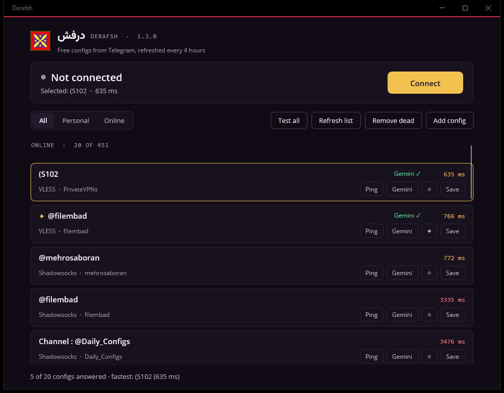

<p align="center">
  
</p>

<h1 align="center">درفش · Derafsh</h1>

<p align="center">
  فیلترشکن رایگان درفش: کلاینت Xray / V2Ray برای ویندوز و اندروید، با ۵۰۰ کانفیگ تازه که هر ۲ ساعت جمع و تست می‌شوند و انتخاب کشور و شهر<br>
  Derafsh: a free Xray / V2Ray VPN client for Windows and Android with 500 fresh configs, collected and tested every 2 hours, and a choice of country and city
</p>

<p align="center">
  <a href="https://github.com/Mehinator/Derafsh/releases/latest"><b>⬇ دانلود آخرین نسخه / Download the latest release</b></a><br>
  <a href="#آیفون-و-آیپد">آیفون و آیپد: لینک اشتراک / iPhone: subscription link</a><br>
  <a href="https://t.me/DERAFSHVPN">کانال تلگرام درفش / Telegram channel: @DERAFSHVPN</a>
</p>

<p align="center">
  اگر درفش به کارتان آمد، با ستاره (<b>★ Star</b> بالای همین صفحه) کمک کنید بقیه هم پیدایش کنند.
</p>

<p align="center"></p>

نام «درفش» از درفش کاویانی آمده: پرچمی که کاوه‌ی آهنگر در برابر ستم ضحاک برافراشت. این برنامه رایگان است و برای این ساخته شده که همه بتوانند به اینترنت آزاد وصل شوند.

---

## فارسی

### دانلود و اجرا (ویندوز)

1. از بخش [Releases](https://github.com/Mehinator/Derafsh/releases/latest) فایل `Derafsh-v…-Windows-x64.zip` را دانلود کنید.
2. فایل را از حالت فشرده خارج کنید و `Derafsh.Client.exe` را اجرا کنید. نصب لازم نیست.
3. اگر ویندوز پیام «Windows protected your PC» داد: روی **More info** و بعد **Run anyway** بزنید (برنامه امضای دیجیتال ندارد).

نیازمندی: ویندوز ۱۰ (نسخه ۱۸۰۹ به بعد) یا ویندوز ۱۱، ۶۴ بیتی.

### طرز استفاده

**صفحه‌ی اصلی** یک دکمه‌ی گرد **اتصال** دارد. درفش خودش سرورها را روی **همان اینترنتی که الان وصل هستید** تست می‌کند و به سریع‌ترین سروری که جواب بدهد وصل می‌شود. زیر آن، **مکان سرور** است: خودکار (هر کشوری)، یا یک کشور (مثلاً آلمان) یا یک شهر (مثلاً برلین). با انتخاب مکان، فقط سرورهای همان‌جا تست و انتخاب می‌شوند، و اگر سرور قطع شود، درفش هم فقط به سرورهای همان‌جا می‌رود. مکان یعنی جایی که سرور به اینترنت وصل می‌شود و سایت‌ها شما را آنجا می‌بینند. اگر در شهر انتخابی سروری جواب ندهد، درفش می‌پرسد به جای دیگری از همان کشور وصل شود یا نه.

**تنظیمات** (دکمه‌ی بالای صفحه):

- **برنامه‌ها و سایت‌های ایرانی بدون VPN** (پیش‌فرض روشن): سایت‌های ایرانی (دامنه‌ی ‎.ir‎، چند سایت پرکاربرد مثل دیجی‌کالا و آپارات، و IPهای ایران) با اینترنت خود دستگاه باز می‌شوند؛ بانک‌ها و درگاه پرداخت فقط IP ایران را قبول می‌کنند. در اندروید، برنامه‌های ایرانی و بانکی هم خودکار بدون VPN می‌مانند.
- **انتخاب برنامه‌ها** (اندروید): خودتان انتخاب کنید کدام برنامه‌ها از VPN استفاده کنند. دو حالت دارد: «همه‌ی برنامه‌ها با VPN، جز آن‌هایی که خاموش کنید» یا «فقط برنامه‌هایی که روشن کنید با VPN».
- **فقط سرورهایی که Gemini (هوش مصنوعی گوگل) را باز می‌کنند**: هم سروری که وصل می‌شوید و هم سرورهای زاپاس Gemini را باز می‌کنند.
- **لینک اشتراک (QR)** برای آیفون و برنامه‌های دیگر، و **کانال تلگرام درفش** ([@DERAFSHVPN](https://t.me/DERAFSHVPN)).

**صفحه‌ی سرورها** (دکمه‌ی «سرورها» بالای صفحه) برای کارهای بیشتر است. از منوی **لیست** یکی را انتخاب کنید:

| لیست | چه چیزی نشان می‌دهد | دکمه‌ها |
|---|---|---|
| **آنلاین** | سرورهای رایگانی که روی همین اینترنت جواب می‌دهند (در مکان انتخابی)، سریع‌ترین بالا | **تست دوباره** · **دریافت لیست تازه** · **بیشتر…** |
| **شخصی** | کانفیگ‌هایی که خودتان اضافه کرده‌اید | **تست دوباره** · **افزودن کانفیگ** · **بیشتر…** |
| **لیست‌های ذخیره‌شده** | هر لیستی که با اسم دلخواه ذخیره کرده‌اید، مثلاً «ایرانسل» یا «وای‌فای خانه» | **تست دوباره** · **بیشتر…** |

**بیشتر…** این‌ها را دارد: ذخیره‌ی سالم‌ها به‌عنوان لیست، اشتراک همه‌ی سالم‌ها، و حذف لیست ذخیره‌شده. روی هر سرور بزنید تا برای اتصال انتخاب شود (در صفحه‌ی اصلی، **خودکار** دوباره انتخاب را به برنامه می‌سپارد). دکمه‌ی **⋯** کنار هر سرور این کارها را دارد: تست سرعت و پینگ، بررسی Gemini، اشتراک (QR و لینک)، ستاره، و افزودن به لیست شخصی یا حذف از آن. زیر هر سرور پروتکل، آدرس، کشور و منبع آن نوشته شده است.

**وصل ماندن:** کانفیگ‌های رایگان زود قطع یا کند می‌شوند. نگهبان اتصال درفش در اندروید داخل خود سرویس VPN کار می‌کند، پس با بسته بودن برنامه هم کار می‌کند:

- **قطعی زود پیدا می‌شود:** اگر برنامه‌ها چیزی بفرستند و چیزی برنگردد، یا دانلودی که در جریان بود ناگهان قطع شود (مثلاً ویدیو بایستد)، درفش همان لحظه اتصال را امتحان می‌کند. اگر دو سایت مختلف پشت سر هم جواب ندهند، سرور مرده حساب می‌شود.
- **زاپاس‌ها همیشه تازه‌اند:** هر ۲ دقیقه چند سرور سالم دیگر با هم امتحان می‌شوند.
- **عوض کردن سریع:** وقتی سرور قطع شود، ۸ سرور با هم تست می‌شوند و اولین سالم جایگزین می‌شود. اگر هیچ‌کدوم جواب ندهد، ۸ تای بعدی امتحان می‌شوند، تا ته لیست. کانفیگ‌های همان سرورِ مرده امتحان نمی‌شوند.
- **وقتی اینترنت خود گوشی قطع است،** درفش سرورها را مرده حساب نمی‌کند و منتظر می‌ماند.
- **کندی:** اگر سرور کند شود و زاپاس سریع‌تری آماده باشد، درفش خودکار به آن می‌رود.
- **«تعویض سرور»:** این دکمه همین الان به یک سرور سالم دیگر می‌رود. در اندروید همین دکمه در اعلان ثابت VPN هم هست، تا وسط ویدیو لازم نباشد برنامه را باز کنید.

**تکه‌تکه کردن TLS** (در تنظیمات، پیش‌فرض روشن): اولین بسته‌ی رمزنگاری هر اتصال تا سرور (ClientHello، که اسم سایت در آن است) به چند تکه‌ی کوچک با چند میلی‌ثانیه فاصله فرستاده می‌شود. فیلتر اسم سایت را نمی‌خواند، اتصال را تشخیص نمی‌دهد و کند یا قطع نمی‌کند. برنامه‌هایی مثل MEH و MahsaNG هم همین کار را می‌کنند. اگر سروری با این گزینه وصل نشد، امتحانی خاموشش کنید.

در اندروید، VPN در تمام این مدت روشن می‌ماند. موقع وصل شدن هم اتصال واقعاً امتحان می‌شود. اگر سروری فقط «وصل» شود ولی اینترنت ندهد، سرور بعدی امتحان می‌شود.

**سرعت، نه فقط پینگ:** پینگ خوب یعنی سرور جواب می‌دهد، نه اینکه ویدیو را روان پخش کند. درفش سرعت دانلود هر سرور را هم اندازه می‌گیرد (کنار هر سرور، مثلاً «۲۴۰ KB/s») و سرورهایی را که برای ویدیو سریع‌اند (۱۵۰ KB/s به بالا) اول انتخاب می‌کند. سروری که فقط به پینگ جواب می‌دهد ولی چیزی دانلود نمی‌کند (در تست، نصف سرورهای پینگ‌دار) سالم حساب نمی‌شود. QUIC (UDP 443) بسته می‌شود تا اینستاگرام و یوتیوب از راه پایدارتر TCP بروند؛ روی سرورهای رایگان QUIC معمولاً همان چیزی است که ویدیو را وسط پخش نگه می‌دارد.

**حافظه‌ی هر اینترنت:** درفش به خاطر می‌سپارد کدام سرورها روی همین اینترنت (ایرانسل، همراه اول، وای‌فای خانه و …) جواب داده‌اند و کدام نه، و دفعه‌ی بعد اول همان‌ها را تست می‌کند. برای همین تست بعدی خیلی سریع‌تر جواب می‌دهد. این اطلاعات فقط روی همین دستگاه می‌ماند.

**تست دقیق:** هر سرور بعد از باز شدن تونل، سه بار دیگر با HTTPS امتحان می‌شود و فقط وقتی «سالم» حساب می‌شود که دست‌کم دو بار جواب بدهد (پینگ = میانه). تست Gemini کشوری را می‌خواند که گوگل شما را در آن می‌بیند؛ بعضی سرورهای رایگان IP خارجی دارند ولی ترافیک گوگل را از ایران رد می‌کنند و Gemini با آن‌ها باز نمی‌شود — این‌ها «Gemini ✗ · IRN» نشان داده می‌شوند.

**نسخه‌ی تازه:** وقتی نسخه‌ی جدیدی روی گیت‌هاب بیاید، بالای برنامه خبر داده می‌شود و دکمه‌ی **دانلود** فایل مخصوص همان دستگاه را می‌گیرد.

در ویندوز، درفش موقع اتصال پروکسی سیستم را روی خودش می‌گذارد و موقع قطع، تنظیم قبلی شما را برمی‌گرداند.

موتور Xray نیز فورک [patterniha/Xray-core](https://github.com/patterniha/Xray-core) است (همان که پترن استفاده می‌کند): اتصال به کانفیگ‌های VLESS/Trojan بدون رمزنگاری روی آدرس‌های عمومی کار می‌کند و پارامترهای `cs=` (cipherSuites) و `alpn` لینک‌ها با قانون http/1.1 برای ws اعمال می‌شوند — همان روشی که تست‌ها را در پترن درست نشان می‌دهد.

### اندروید

1. از بخش [Releases](https://github.com/Mehinator/Derafsh/releases/latest) یکی از این فایل‌ها را روی گوشی دانلود کنید:
   - `Derafsh-v…-Android-arm64.apk`: بیشتر گوشی‌های چند سال اخیر
   - `Derafsh-v…-Android-armv7.apk`: گوشی‌های قدیمی‌تر و ارزان‌تر (۳۲ بیتی). اگر arm64 نصب نشد، این را بگیرید
   - `Derafsh-v…-Android-universal.apk`: اگر نمی‌دانید کدام؛ روی همه کار می‌کند ولی حجمش بیشتر است
2. فایل را باز کنید. اگر اندروید اجازه‌ی «نصب برنامه‌های ناشناس» خواست، برای همان مرورگر یا فایل‌منیجر اجازه بدهید و **Install** را بزنید.
3. در درفش یک کانفیگ را انتخاب کنید و **Connect** را بزنید. بار اول اندروید می‌پرسد که درفش اجازه‌ی ساختن VPN دارد یا نه: **OK** را بزنید.

نیازمندی: اندروید ۶ به بعد.

اگر می‌خواهید از برنامه‌ی دیگری استفاده کنید، همین لیست را می‌توانید در **v2rayNG**، **Hiddify** یا **NekoBox** هم اضافه کنید؛ هر ۲ ساعت خودکار به‌روز می‌شود:

1. در برنامه به بخش **Subscription group setting** (تنظیمات اشتراک) بروید و **+** را بزنید.
2. این آدرس را وارد کنید:
   ```
   https://cdn.jsdelivr.net/gh/Mehinator/Derafsh@main/derafsh_sub.txt
   ```
3. **Update subscription** را بزنید، کانفیگ‌ها را تست کنید و به یکی از سریع‌ها وصل شوید.

### آیفون و آیپد

درفش هنوز نسخه‌ی iOS ندارد، ولی همین لیست کانفیگ‌ها روی آیفون و آیپد هم کار می‌کند:

1. یکی از این برنامه‌های رایگان را از App Store نصب کنید: **Hiddify**، **V2Box** یا **Streisand**. (App Store رسماً در ایران فعال نیست؛ این برنامه‌ها در App Store کشورهای دیگر هستند.)
2. در برنامه، افزودن اشتراک (**Subscription** یا **+**) را بزنید و این آدرس را وارد کنید، یا QR زیر را با همان برنامه اسکن کنید:
   ```
   https://cdn.jsdelivr.net/gh/Mehinator/Derafsh@main/derafsh_sub.txt
   ```
   
3. لیست را به‌روز کنید، سرورها را تست کنید (**Ping** یا **Test**) و به یکی از سریع‌ها وصل شوید. لیست هر ۲ ساعت خودکار تازه می‌شود.

این برنامه‌ها مثل درفش سرورها را روی اینترنت خود شما نمی‌سنجند، پس بعضی از سرورهای لیست جواب نمی‌دهند؛ اول تست کنید و یکی از سالم‌ها را انتخاب کنید.

### کانفیگ‌ها از کجا می‌آیند؟

اسکریپت [`collector.py`](collector.py) هر ۲ ساعت روی GitHub Actions اجرا می‌شود:

1. صفحه‌ی عمومی چند کانال تلگرام و چند لیست عمومی گیت‌هاب را می‌خواند (فهرست در همان فایل؛ از جمله [SoliSpirit](https://github.com/SoliSpirit/v2ray-configs)، [barry-far](https://github.com/barry-far/V2ray-Config)، [mhcfpTopic](https://github.com/mhcfpTopic/config)، [PSG](https://github.com/itsyebekhe/PSG) و [rzashakeri](https://github.com/rzashakeri/v2ray-configs)).
2. هر کانفیگ را با خود Xray تست می‌کند، با همان کدی که برنامه با آن وصل می‌شود ([`tools/ConfigTester`](tools/ConfigTester)): باید از داخل آن جواب گوگل بیاید و واقعاً دانلود کند. از داخل همان کانفیگ، کشور و شهری را هم که سرور از آن به اینترنت وصل می‌شود پیدا می‌کند و اسم کانفیگ را مثلاً «🇩🇪 Berlin» می‌گذارد. کانفیگ‌هایی که از خود ایران بیرون می‌آیند کنار می‌روند، چون فیلتر را دور نمی‌زنند.
3. از حدود ۲۰۰۰ کانفیگ سالم، **۵۰۰ تای بهتر** را نگه می‌دارد:
   - **ترتیب:** اول سرعت کافی برای ویدیو، بعد رمزنگاری TLS یا Reality (کانفیگ‌های بدون رمزنگاری را فیلتر راحت پیدا می‌کند)، بعد اینکه چند اجرای پشت سر هم سالم مانده (کمتر وسط ویدیو می‌میرد)، بعد نزدیکی به ایران.
   - **مکان:** از هر شهر چند سرور حتماً در لیست می‌ماند تا انتخاب شهر خالی نماند.
   - **بدون تکرار:** از هر سرور واقعی فقط یک کانفیگ می‌ماند. سرور واقعی یعنی همان کاربر و همان دامنه‌ی پشتش، حتی اگر لیست‌ها آن را با IP یا path دیگری گذاشته باشند. از هر رنج IP هم حداکثر سه تا می‌آید، تا وقتی یک اپراتور قطع می‌شود، زاپاس‌ها با آن قطع نشوند.
   - **کم‌کاربرتر:** کانفیگی که در کانال‌ها و لیست‌های زیادی پخش شده، کاربر زیادی دارد و شلوغ است، پس پایین‌تر می‌رود.
   - **اسم:** اسم‌های یکسان شماره می‌گیرند، مثلاً «🇩🇪 Berlin 1» و «🇩🇪 Berlin 2».

این تست بیرون از ایران انجام می‌شود، پس فقط سرورهای مرده را کنار می‌گذارد. اینکه کدام سرور روی اینترنت شما باز است را خود برنامه روی گوشی یا کامپیوتر شما می‌سنجد. خروجی چهار فایل است:

| فایل | محتوا |
|---|---|
| [`derafsh_servers.txt`](derafsh_servers.txt) | لیست کانفیگ‌ها، بهترین‌ها اول |
| [`derafsh_sources.json`](derafsh_sources.json) | منبع هر کانفیگ (کانال تلگرام یا لیست گیت‌هاب) |
| [`derafsh_locations.json`](derafsh_locations.json) | کشور و شهر هر کانفیگ، برای «مکان سرور» |
| [`derafsh_sub.txt`](derafsh_sub.txt) | همان لیست به شکل اشتراک استاندارد (base64) برای اپ‌های دیگر |

### نکته‌ی امنیتی

کانفیگ‌ها رایگان و از کانال‌های عمومی هستند و صاحب سرورها ناشناس‌اند. برای کارهای حساس (بانک، حساب‌های مهم) فقط از سایت‌های HTTPS استفاده کنید و رمزهای مهم را از طریق کانفیگ ناشناس وارد نکنید.

---

## English

**Derafsh** collects free V2Ray/Xray configs from public Telegram channels and public GitHub lists every 2 hours, and tests each one with Xray (through the app's own config builder, [`tools/ConfigTester`](tools/ConfigTester)) so dead ones never reach the list (GitHub Actions + [`collector.py`](collector.py)). The test also finds the country and city each config comes out in (configs are named like "🇩🇪 Berlin"), and the best 500 are kept. The ranking puts speed first, then TLS or REALITY over plain, then how many runs in a row a config kept working, then closeness to Iran. Every city keeps a few servers, and no server gets more than two entries.

The app (in Persian) connects with one button. It tests the configs on the network you're on (ping and download speed, remembering per network which servers worked) and picks the fastest one that answers. You can limit it to a country or a city, or to servers that open Gemini. While connected, a guard inside the VPN service keeps a few tested spares. When your apps send but nothing comes back, or a running download stops, it checks the connection at once. If the server is dead, it tests 8 others at a time and moves to the first that answers, walking the whole list if it has to. The TLS ClientHello to the server is sent in small, paced fragments (on by default) so the filter can't read the site name and slow the connection down, and "switch server" is also a button in the Android notification. Iranian sites (.ir, Iranian IPs) go direct, and on Android you choose which apps use the VPN (all except some, or only some); Iranian and banking apps are left out automatically. A second screen lists the servers (online, personal, and lists you save under your own names) for testing and choosing by hand — through the system proxy on Windows, as a VPN on Android. News and releases: [t.me/DERAFSHVPN](https://t.me/DERAFSHVPN).

- **Download:** [Releases](https://github.com/Mehinator/Derafsh/releases/latest) — `Windows-x64.zip` (unzip and run, Windows 10 1809+); Android 6+: `Android-arm64.apk` (most phones), `Android-armv7.apk` (32-bit phones) or `Android-universal.apk` (both).
- **Protocols:** VLESS (TCP, WebSocket, gRPC, XHTTP, HTTPUpgrade; TLS, REALITY), VMess, Shadowsocks, Trojan, Hysteria2 — on **Xray-core 26.10.22** (the patterniha fork). Configs the engine can't start, or that don't really download, are dropped by the collector.
- **Other apps:** the same list works as a subscription in v2rayNG, Hiddify or NekoBox: `https://cdn.jsdelivr.net/gh/Mehinator/Derafsh@main/derafsh_sub.txt`.
- **iPhone / iPad:** no iOS app yet; add the same subscription URL in Hiddify, V2Box or Streisand from the App Store, or scan [this QR code](docs/sub-qr.png).
- **Safety:** these are free servers run by unknown people. Prefer HTTPS sites and don't enter important passwords over them.

### Build from source

Requirements: Windows 10 1809+, the [.NET 10 SDK](https://dotnet.microsoft.com/download/dotnet/10.0) with the MAUI Windows workload (`dotnet workload install maui-windows`), or Visual Studio with the .NET MAUI workload.

```powershell
# run from source
dotnet build Derafsh.Client -c Debug
# self-contained release folder (what the release zip contains)
dotnet publish Derafsh.Client -f net10.0-windows10.0.19041.0 -p:TargetFrameworks=net10.0-windows10.0.19041.0 -c Release -r win-x64 --self-contained true `
  -p:WindowsPackageType=None -p:WindowsAppSDKSelfContained=true -p:PublishReadyToRun=true -o publish\Derafsh
# Android APK (needs the MAUI Android workload and a JDK); DerafshAndroidAbis = arm64 (default), armv7 or universal
dotnet build Derafsh.Client -f net10.0-android -c Release -p:DerafshAndroidAbis=arm64
```

The first build downloads Xray-core (and, for Android, hev-socks5-tunnel) from their official releases and checks their SHA-256.
Pushing a `v*` tag runs [`release.yml`](.github/workflows/release.yml), which builds both and attaches them to the release.

The config collector: `pip install requests` then `python collector.py`.

### Project layout

| Path | What it is |
|---|---|
| `Derafsh.Client/` | .NET MAUI app (`MainPage.xaml` UI, `Service/ConfigService.cs` link parsing and Xray config, `XrayProc.cs` engine process, `Resources/Styles/Theme.xaml` design tokens) |
| `Derafsh.Client/Platforms/Android/DerafshVpn.cs` | Android VPN: TUN → hev-socks5-tunnel → Xray SOCKS |
| `collector.py`, `.github/workflows/update_configs.yml` | the 4-hourly config collector |
| `.github/workflows/release.yml` | release builds (Windows zip, signed APK) |

### License

MIT — see [LICENSE](LICENSE). Bundled third-party software (Xray-core, MPL-2.0; Vazirmatn font, OFL-1.1) is listed in [THIRD_PARTY_NOTICES.md](THIRD_PARTY_NOTICES.md).
