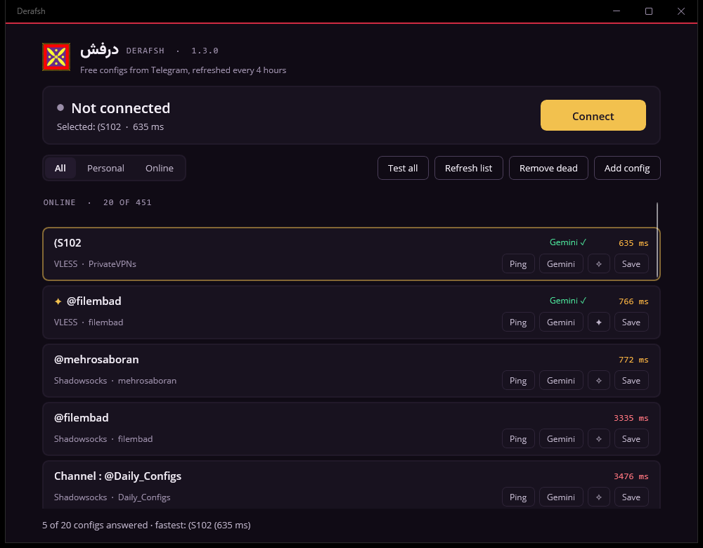

<p align="center">
  
</p>

<h1 align="center">درفش · Derafsh</h1>

<p align="center">
  کلاینت رایگان Xray برای ویندوز و اندروید، با کانفیگ‌های تازه از تلگرام — هر ۴ ساعت<br>
  A free Xray client for Windows and Android with fresh configs from Telegram, refreshed every 4 hours
</p>

<p align="center">
  <a href="https://github.com/Mehinator/Derafsh/releases/latest"><b>⬇ دانلود آخرین نسخه / Download the latest release</b></a>
</p>

<p align="center"></p>

نام «درفش» از درفش کاویانی آمده: پرچمی که کاوه‌ی آهنگر در برابر ستم ضحاک برافراشت. این برنامه رایگان است و برای این ساخته شده که همه بتوانند به اینترنت آزاد وصل شوند.

---

## فارسی

### دانلود و اجرا (ویندوز)

1. از بخش [Releases](https://github.com/Mehinator/Derafsh/releases/latest) فایل `Derafsh-v…-Windows-x64.zip` را دانلود کنید.
2. فایل را از حالت فشرده خارج کنید و `Derafsh.Client.exe` را اجرا کنید. نصب لازم نیست.
3. اگر ویندوز پیام «Windows protected your PC» داد: روی **More info** و بعد **Run anyway** بزنید (برنامه امضای دیجیتال ندارد).

نیازمندی: ویندوز ۱۰ (نسخه ۱۸۰۹ به بعد) یا ویندوز ۱۱، ۶۴ بیتی.

### طرز استفاده

با باز شدن برنامه، درفش خودش کانفیگ‌های تازه را روی **همان اینترنتی که الان وصل هستید** تست می‌کند و فقط آن‌هایی را نشان می‌دهد که جواب می‌دهند، سریع‌ترین بالا. سریع‌ترین هم خودکار انتخاب می‌شود؛ کافی است **Connect** را بزنید.

| دکمه | کار |
|---|---|
| **Connect** | به کانفیگ انتخاب‌شده وصل می‌شود (در ویندوز پروکسی سیستم، در اندروید VPN روشن می‌شود و IP و کشور واقعی نمایش داده می‌شود) |
| **Test all** | دوباره روی همین اینترنت تست می‌کند (مثلاً وقتی از وای‌فای به اینترنت گوشی رفتید) |
| **Refresh list** | تازه‌ترین کانفیگ‌ها را دانلود و خودکار تست می‌کند |
| **Save list** | کانفیگ‌هایی را که الان جواب می‌دهند با اسمی که خودتان می‌گذارید ذخیره می‌کند، مثلاً «ایرانسل» یا «وای‌فای خونه». هر اسم یک لیست جداست |
| **Add config** | لینک‌های خودتان (vless / vmess / ss / trojan / hysteria2) را به لیست شخصی اضافه می‌کند |
| **Ping** / **Gemini** | سرعت یک کانفیگ را تست می‌کند / بررسی می‌کند که Gemini از طریق آن باز می‌شود یا نه |
| **✧** / **Save** | کانفیگ را به علاقه‌مندی‌ها اضافه می‌کند / در لیست شخصی ذخیره می‌کند |

تب **Saved** لیست‌های ذخیره‌شده را نشان می‌دهد (با دکمه‌ی **Delete list** برای پاک کردن). زیر هر کانفیگ آدرس سرور و کانال تلگرامی که از آن آمده نوشته شده است.

کانفیگ‌های رایگان زود فیلتر می‌شوند: کانفیگی که چند دقیقه پیش جواب می‌داد ممکن است الان جواب ندهد. این مشکل برنامه نیست؛ **Test all** را دوباره بزنید.

### اندروید

1. از بخش [Releases](https://github.com/Mehinator/Derafsh/releases/latest) یکی از این فایل‌ها را روی گوشی دانلود کنید:
   - `Derafsh-v…-Android-arm64.apk`: بیشتر گوشی‌های چند سال اخیر
   - `Derafsh-v…-Android-armv7.apk`: گوشی‌های قدیمی‌تر و ارزان‌تر (۳۲ بیتی). اگر arm64 نصب نشد، این را بگیرید
   - `Derafsh-v…-Android-universal.apk`: اگر نمی‌دانید کدام؛ روی همه کار می‌کند ولی حجمش بیشتر است
2. فایل را باز کنید. اگر اندروید اجازه‌ی «نصب برنامه‌های ناشناس» خواست، برای همان مرورگر یا فایل‌منیجر اجازه بدهید و **Install** را بزنید.
3. در درفش یک کانفیگ را انتخاب کنید و **Connect** را بزنید. بار اول اندروید می‌پرسد که درفش اجازه‌ی ساختن VPN دارد یا نه: **OK** را بزنید.

نیازمندی: اندروید ۷ به بعد.

اگر می‌خواهید از برنامه‌ی دیگری استفاده کنید، همین لیست را می‌توانید در **v2rayNG**، **Hiddify** یا **NekoBox** هم اضافه کنید؛ هر ۴ ساعت خودکار به‌روز می‌شود:

1. در برنامه به بخش **Subscription group setting** (تنظیمات اشتراک) بروید و **+** را بزنید.
2. این آدرس را وارد کنید:
   ```
   https://cdn.jsdelivr.net/gh/Mehinator/Derafsh@main/derafsh_sub.txt
   ```
3. **Update subscription** را بزنید، کانفیگ‌ها را تست کنید و به یکی از سریع‌ها وصل شوید.

### کانفیگ‌ها از کجا می‌آیند؟

اسکریپت [`collector.py`](collector.py) هر ۴ ساعت روی GitHub Actions اجرا می‌شود: صفحه‌ی عمومی چند کانال تلگرام (فهرست در همان فایل) را می‌خواند، لینک‌های خراب و تکراری را حذف می‌کند و سه فایل می‌سازد:

| فایل | محتوا |
|---|---|
| [`derafsh_servers.txt`](derafsh_servers.txt) | لیست کانفیگ‌ها، جدیدترین‌ها اول |
| [`derafsh_sources.json`](derafsh_sources.json) | منبع (کانال) هر کانفیگ |
| [`derafsh_sub.txt`](derafsh_sub.txt) | همان لیست به شکل اشتراک استاندارد (base64) برای اپ‌های دیگر |

### نکته‌ی امنیتی

کانفیگ‌ها رایگان و از کانال‌های عمومی هستند و صاحب سرورها ناشناس‌اند. برای کارهای حساس (بانک، حساب‌های مهم) فقط از سایت‌های HTTPS استفاده کنید و رمزهای مهم را از طریق کانفیگ ناشناس وارد نکنید.

---

## English

**Derafsh** collects free V2Ray/Xray configs from public Telegram channels every 4 hours (GitHub Actions + [`collector.py`](collector.py)), and the app tests them on the network you're on, shows only the ones that answer (fastest first), lets you save working lists under your own names (e.g. one per internet provider), and connects with one click — through the system proxy on Windows, as a VPN on Android.

- **Download:** [Releases](https://github.com/Mehinator/Derafsh/releases/latest) — `Windows-x64.zip` (unzip and run, Windows 10 1809+); Android 7+: `Android-arm64.apk` (most phones), `Android-armv7.apk` (32-bit phones) or `Android-universal.apk` (both).
- **Protocols:** VLESS (TCP, WebSocket, gRPC, XHTTP, HTTPUpgrade; TLS, REALITY), VMess, Shadowsocks, Trojan, Hysteria2 — on **Xray-core 26.3.27**. Configs the engine can't start are dropped by the collector.
- **Other apps:** the same list works as a subscription in v2rayNG, Hiddify or NekoBox: `https://cdn.jsdelivr.net/gh/Mehinator/Derafsh@main/derafsh_sub.txt`.
- **Safety:** these are free servers run by unknown people. Prefer HTTPS sites and don't enter important passwords over them.

### Build from source

Requirements: Windows 10 1809+, the [.NET 10 SDK](https://dotnet.microsoft.com/download/dotnet/10.0) with the MAUI Windows workload (`dotnet workload install maui-windows`), or Visual Studio with the .NET MAUI workload.

```powershell
# run from source
dotnet build Derafsh.Client -c Debug
# self-contained release folder (what the release zip contains)
dotnet publish Derafsh.Client -f net10.0-windows10.0.19041.0 -p:TargetFrameworks=net10.0-windows10.0.19041.0 -c Release -r win-x64 --self-contained true `
  -p:WindowsPackageType=None -p:WindowsAppSDKSelfContained=true -p:PublishReadyToRun=true -o publish\Derafsh
# Android APK (needs the MAUI Android workload and a JDK); DerafshAndroidAbis = arm64 (default), armv7 or universal
dotnet build Derafsh.Client -f net10.0-android -c Release -p:DerafshAndroidAbis=arm64
```

The first build downloads Xray-core (and, for Android, hev-socks5-tunnel) from their official releases and checks their SHA-256.
Pushing a `v*` tag runs [`release.yml`](.github/workflows/release.yml), which builds both and attaches them to the release.

The config collector: `pip install requests` then `python collector.py`.

### Project layout

| Path | What it is |
|---|---|
| `Derafsh.Client/` | .NET MAUI app (`MainPage.xaml` UI, `Service/ConfigService.cs` link parsing and Xray config, `XrayProc.cs` engine process, `Resources/Styles/Theme.xaml` design tokens) |
| `Derafsh.Client/Platforms/Android/DerafshVpn.cs` | Android VPN: TUN → hev-socks5-tunnel → Xray SOCKS |
| `collector.py`, `.github/workflows/update_configs.yml` | the 4-hourly config collector |
| `.github/workflows/release.yml` | release builds (Windows zip, signed APK) |

### License

MIT — see [LICENSE](LICENSE). Bundled third-party software (Xray-core, MPL-2.0; Vazirmatn font, OFL-1.1) is listed in [THIRD_PARTY_NOTICES.md](THIRD_PARTY_NOTICES.md).
